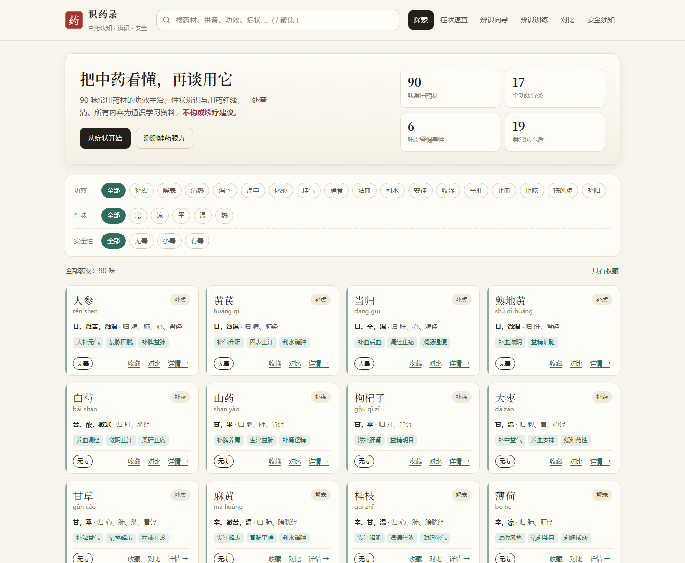

# 识药录 · 中药认知与安全指引

一个纯静态的中药知识站：查功效、看辨识要点、记用药红线。**双击 `index.html` 即可打开**，不需要安装任何东西、不需要联网、没有后端。

> ⚠️ 本站是通识科普与药材性状识别的学习资料，**不诊断、不处方、不提供个人用药剂量建议**，不能替代执业医师。



## 它解决什么问题

| 需求 | 对应功能 |
| --- | --- |
| 充分了解中药的作用 | 90 味药，每味含功效、主治、用法用量、现代研究提示 |
| 会识别 | 「辨识要点」页：性状特征、断面、气味；「易混与伪品」单列（如土三七冒三七有肝毒性） |
| 知道注意事项 | 「用药注意」页 + 「安全须知」页：十八反、十九畏、妊娠禁忌、毒性药材清单、中毒急救信号 |
| 交互性高 | 实时搜索、三组筛选、收藏、多药对比、症状速查、辨药小测、深链分享 |
| 页面简洁、有指导 | 首访三步引导、每页一句"这一步在做什么"、卡片式信息密度控制 |

## 打开方式

**方式一（最简单）**：双击 `tcm-site/index.html`。

**方式二（本地服务器，推荐用于长期使用）**：

```powershell
# 在 tcm-site 的上一级目录执行
python -m http.server 8788 -d tcm-site
# 浏览器打开 http://127.0.0.1:8788/
```

> 用 `file://` 直接打开时，部分浏览器会禁用 `localStorage`，此时收藏/对比不会跨次保留；用上面的本地服务器就没有这个问题。

## 功能地图

**探索**：搜索框（支持药名、拼音 `renshen`、别名、功效词如"安胎"、主治症状），三组筛选（功效 / 性味 / 安全性），卡片可收藏、加入对比、打开详情。

**详情抽屉**：四个标签页
1. 功效主治 — 性味归经、功效、主治、用法用量、现代研究提示
2. 辨识要点 — 性状辨识、易混与伪品
3. 用药注意 — 禁忌人群、毒性警示、特殊人群提示
4. 配伍 — 常见配伍、配伍禁忌速记

**症状速查**：19 类常见不适 → 相关药材 + 明确的"不能照着买"解释。

**辨识向导**：先选药用部位（根/根茎/鳞茎/全草/皮/花/果实…16 类），再逐条对断面、气味、表面特征。**有毒药材排在最前**，目的不是"认出它是什么"，而是先判断能不能排除有毒混淆品。

**辨识训练**：13 道人工校对的选择题，答完给解析，考的是断面特征、毒性、十八反这类硬知识。

**对比**：最多 3 味药横向对比性味、归经、功效、主治、用量、关键禁忌、毒性。

**安全须知**：十八反、十九畏、妊娠禁忌、毒性药材清单、煎服要点、必须立即就医的信号。

**键盘**：`/` 聚焦搜索框，`Esc` 关闭详情。

**深链**：
- `index.html#renshen` — 直接打开人参详情
- `index.html#renshen/usage` — 直达某个标签页（`effect` / `identify` / `usage` / `caution` / `pairs`）
- `index.html#/quiz` — 直接进辨识训练（另有 `#/safety`、`#/symptom`、`#/wizard`、`#/compare`）
- `index.html#/wizard?part=根` — 直达辨识向导的某个部位
- `index.html?nointro` — 跳过首访引导（演示/截图用）

## 文件结构

```
tcm-site/
├── index.html      页面结构（6 个视图 + 详情抽屉 + 引导层）
├── styles.css      视觉与响应式（暖纸底色、宋体标题、朱砂/青瓷点缀）
├── data.js         核心内容：HERBS / SYMPTOMS / QUIZ
├── data-extra.js   扩展字段：产地 / 部位 / 用法 / 忌口 + 向导分组
├── app.js          交互逻辑（无依赖，约 700 行）
├── assets/herbs/   药材图片目录（当前为空，说明见其中 README）
└── preview/        各页面截图
```

## 怎么加一味药

在 `data.js` 的 `HERBS` 数组里追加一个对象即可，字段含义：

| 字段 | 说明 |
| --- | --- |
| `id` | 唯一 key（英数），用于深链与对比 |
| `name` / `py` / `pyDisp` | 中文名 / 无调拼音（搜索用）/ 带调拼音（展示用） |
| `alias` | 别名数组，参与搜索 |
| `cat` | 功效分类，须在 `app.js` 的 `CATS` 里存在 |
| `nature` / `natureTag` | 性味描述 / 归一化标签（寒 凉 平 温 热） |
| `meridians` | 归经数组 |
| `effects` / `indications` | 功效 / 主治，数组 |
| `dosage` | 用法用量（**不要写个人化的"建议服用量"**） |
| `cautions` | 禁忌与风险，数组，详情页会标红 |
| `identify` / `confusion` | 辨识要点 / 易混伪品 |
| `pairs` | 常见配伍 |
| `research` | 现代研究提示（一句话，注明是研究提示而非功效承诺） |
| `tox` | `无毒` / `小毒` / `有毒` |

扩展字段写在 `data-extra.js` 的 `HERB_EXTRA`（按 `id` 对应），不塞进 `data.js`，这样新增一味药时核心字段和扩展字段互不干扰：

| 扩展字段 | 说明 |
| --- | --- |
| `origin` | 道地产区（传统优质产区） |
| `part` | 药用部位，须在 `PARTS` 里存在（决定向导分组） |
| `usage` | 使用方法（煎服/外用/食疗的通用做法，不含个人剂量） |
| `dietary` | 忌口与饮食配合（传统经验，非绝对禁忌） |

**图片不走数据字段**：按约定读取 `assets/herbs/<id>.jpg`，缺图时自动显示占位说明。为什么不预置图片、怎么补图、署名要求，见 [assets/herbs/README.md](assets/herbs/README.md)。

改完刷新页面即可，无需构建。数据层有自检脚本（见下）。

## 自检

```powershell
node --check data.js
node --check app.js
```

仓库外还跑过一套 jsdom 行为测试（44 项：渲染、搜索、筛选、抽屉、收藏、对比、症状、测验、安全页、键盘），全部通过后可发布。

## 内容边界（重要）

- 剂量只写《中国药典》/ 教材口径的**通用范围**，并注明"遵医嘱"，不针对个人。
- 毒性药材（附子、半夏、苦杏仁）单独标注，并在详情页与安全页双重提示。
- 症状速查只做**检索**，并明确写出"同名症状病因不同、方向可能相反"。
- 不做"万能方""养生套餐"类的推荐，不提供中成药购买引导。

## 后续可以加什么

- 真图素材（需自行取得授权的药材照片，`identify` 字段可关联图片）
- 按归经筛选（数据已有 `meridians`，只需加一组 chips）
- 学习进度（已读/已测）与错题本
- 导出对比结果为图片/PDF
